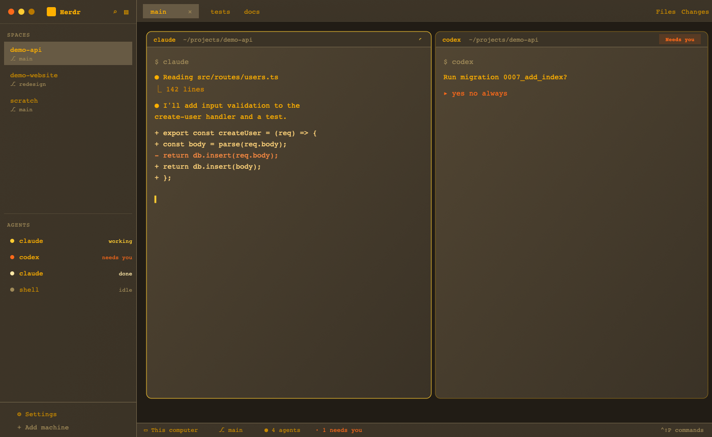

# Amber

A warm, retro-terminal look for Herdr: amber text on dark brown, a sidebar of spaces and agents on the left, tabs on top, rounded pane cards in the middle, an optional Files/Changes panel on the right and a one-line status bar. Everything is set in BlexMono Nerd Font Mono (IBM Plex Mono patched with Nerd Font icons).

## What you see

Left to right, top to bottom. No native title bar (`titlebar: "none"`); the window background is `canvas` (`#211c15`). Dividers are 1px `border` (`#74664b`).

- **Sidebar** (268px, not drag-resizable, may collapse to a narrow rail via its toggle), background gradient `#3e3528` → `#3b3326` at 160°:
  - **Brand row** (46px, drags the window): on macOS 76px of left padding for the traffic lights, the Herdr logo (20px), the word "Herdr" in semibold, a search button (opens the picker) and a sidebar toggle.
  - **Spaces** and **Agents** lists, equal weight, each at least 90px tall.
  - **Footer** (69px, top border): "Settings" (with a small `accent` dot when an app update is ready) and a dimmed "Add machine".
- **Tabs bar** (42px, same gradient as the sidebar, drags the window): the space's tabs; the active tab shows a close button; double-click renames, drag reorders, scrolling the wheel switches tabs. Toggle buttons for the Files and Changes panels sit on the right, and on Windows (or when the window reports buttons) minimize/maximize/close.
- **Work area** (8px padding, 8px gap): the active tab's panes, and on the right the optional **panel** (368px, min 280, max 900, hidden until toggled) which stacks **Files** and **Changes**.
- **Pane cards**: gradient `#524633` → `#3a3226` at 160°, 1px border `#8a6a1c`, focused pane's border becomes `accent` (`#ffcc33`), **corner radius 10**, 8px gap between panes. A lone pane is still framed (`lone: true`). Terminals have 0.88 opacity and padding of 14px vertical, 12px horizontal.
- **Status bar** (28px, top border, 11.8px text in `muted`): where the space runs ("This computer" or the machine name), the git branch if any, an agent count (plus "· N needs you" in `blocked` orange when any agent is blocked), and on the right the key bound to the command palette (e.g. `⌃⇧P  commands`).

Type: terminals use BlexMono Nerd Font Mono at 16px; the panels also use it (`ui_font`).

## How it behaves

Agent status colors (from the theme): **working** `#ffcc33` (a spinning icon in the pane header), **blocked** `#ff6a1a` (a "Needs you" badge in the pane header, counted in the status bar), **done** `#ffe9a8` (a small dot in the pane header), **idle** `#a08a58`.

- **Pane header** (30px, always shown, bottom border): program icon, the agent's or terminal's name (medium weight, up to 260px), the folder (`~`-shortened, dim, truncated), then the status. Hovering the header reveals four buttons: split right, split down, zoom/unzoom, close. Clicking the header focuses the pane.
- **Spaces list**: click selects, drag reorders, a `+` creates a space (per machine when remote machines are added). Each space can carry a color; machines can be folded.
- **Agents list**: sorted by a choosable order; click focuses the agent's pane, other terminals can be peeked, and terminals can be pinned.
- **Files panel**: a folder tree of the focused pane's folder (first 501 entries per folder, `.git` hidden), with git status marks.
- **Changes panel**: the git working-tree changes of the focused pane's repo with a diff view per file.
- **Sidebar toggle** switches between the full sidebar and a narrow rail (76px on macOS to leave room for the traffic lights, 44px elsewhere) and remembers the width it had.
- Corners inside the mods (buttons, badges, list rows) are deliberately square (`rounded(0)`); only the pane cards are rounded.

## Built from

`themes/amber.json`, `layouts/amber.json`, eight mods in `mods/` (all start as clones of the shipped mods at Herdr 0.1.14: `cloned_from` in each `mod.json`).

**Theme** (`themes/amber.json`): terminal background `#3b3326`, foreground `#ffb000`, selection `#6e5a2c`, cursor `#ffcc33`; a 16-color ANSI ramp in ambers and oranges (black `#40372a`, red `#ff6a1a`, bright white `#fff0c4`, and so on). Named colors: `chrome #2b251b`, `canvas #211c15`, `surface #3b3326`, `popover #463d2e`, `raised #4f4534`, `hover #5a4f3c`, `selected #675a44`, `border #74664b`, `input #9a8350`, `muted #c98a00`, `dim #a08a58`, `accent #ffcc33`, `accent_foreground #3b3326`, `solid #ffb000`, `solid_foreground #3b3326`, plus the four status colors above.

**Layout** (`layouts/amber.json`): root row of `sidebar` (column: `brand`, `sidebar-lists` = `spaces` + `agents`, `sidebar-footer`) and `work` (column: `tabs`, `work-body` row of `main` + `panel`, `status`). `main` is the tab block: `{ "tab": "active", "pane": { header: amber-pane, 30px, always, top; gradient background; border; focus; radius 10; gap 8; lone true } }`. `panel` is a column with a `stack` (`panel-body`, active `files`) of `files` and `changes`, 368px, `hidden: true`. Root settings: `theme: "amber"`, `terminal_opacity: 0.88`, `terminal_padding: [14, 12]`, `font` and `ui_font` "BlexMono Nerd Font Mono", `font_size: 16`, `titlebar: "none"`, `traffic_lights: [12, 16]`, `divider` 1px `border`.

**Mods** (each `mods/<name>/main.js` + `mod.json`, `place: "none"` so they only appear where the layout puts them):

| Mod | Role |
| --- | --- |
| `amber-workspace-chrome` | Brand row and, with `props: { footer: true }`, the sidebar footer. Uses `layout()`, `shared`, `updates()`, `window()`. |
| `amber-spaces` | Spaces list with remote machines. Runs `git status` / `git rev-parse` per space and `hc machine ls --json` (herdr-core CLI). Keeps folded/reconnecting machines in `localStorage`; space colors in `shared("space.colors")`. |
| `amber-agents` | Agents list, sort order in `shared("agents.sort")`, peek and pin via `terminal.peek` / `terminal.pin`. |
| `amber-tabs` | Tabs bar, panel toggles (`layout.show/hide/select`), window buttons. |
| `amber-pane` | Pane header. Commands: `pane.focus`, `pane.split`, `pane.zoom`, `pane.close`. |
| `amber-files` | File tree. Runs `sh -c` (or PowerShell on Windows) to list folders, and `git status`. |
| `amber-changes` | Git changes and diffs. Runs `git rev-parse`, `git diff` and related read-only commands. |
| `amber-workspace-status` | Status bar. Reads `spaces()`, `agents()`, `keys()`, `window()`; runs `app.palette` on click. |

Art: each mod carries its own SVG icons in its folder. The mods also reference icons and an image from Herdr itself: `mods/pane/close.svg`, `mods/workspace-chrome/spinner.svg`, `mods/workspace-chrome/plus.svg` and `frame/welcome/herdr.png`.

## Watch out

- **Fonts:** install BlexMono Nerd Font Mono first (`brew install --cask font-blex-mono-nerd-font` or https://www.nerdfonts.com/font-downloads, "BlexMono") and restart Herdr. Without it terminals fall back to JetBrains Mono and the panels to the default UI font. Different Plex builds (`.otf` from IBM vs `.ttf` from Google Fonts) look slightly different.
- **Programs run:** `amber-files`, `amber-changes` and `amber-spaces` run `git` and `sh` (PowerShell on Windows); `amber-spaces` also runs `hc`. No mod uses the network.
- **Hardcoded colors:** gradients and the pane border (`#8a6a1c`) are literal hex values in the layout, not theme names, so changing the theme file alone won't recolor them.
- **Sizes:** sidebar 268px (fixed, `resizable: false`), tabs 42px, status 28px, pane header 30px, panel 368px (280–900).
- **Version:** built against Herdr 0.1.14; the mods depend on shipped mods and assets named above, so a different version may need adjusting.
- Names `amber` and `amber-*` may clash with an existing install; rename the layout, theme and mod folders (and the `mod` names in the layout) if so.

## Done when

- `herdr-app check` passes for every `amber-*` mod, and `layout.switch {name: "amber"}` opens the layout.
- The window has no native title bar, an amber-on-brown palette, and BlexMono Nerd Font Mono throughout.
- Pane cards have rounded corners (radius 10) with an 8px gap; the focused one has a yellow (`#ffcc33`) border.
- Hovering a pane header shows split-right, split-down, zoom and close buttons, and each works.
- A working agent shows a spinner in its pane header; a blocked one shows "Needs you" and the status bar counts it.
- The Files and Changes toggles in the tabs bar show and hide the 368px right panel, and Changes lists the repo's modified files.
- The sidebar toggle collapses to a rail and back to 268px.
- The status bar shows the machine name, the branch (in a git folder), the agent count and the palette key.
